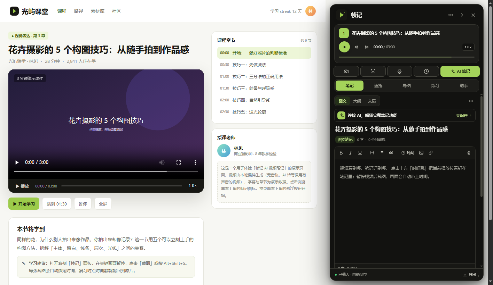

# 帧记 · AI 视频笔记（FrameNote）

[](https://github.com/m1429155411-bot/framenote/releases/latest)
[](LICENSE)
[](https://developer.chrome.com/docs/extensions/develop/migrate/what-is-mv3)

一个类似「百度网盘 AI 笔记」的浏览器扩展：在任意网页视频旁打开侧栏，边看边记，笔记自动绑定时间戳；支持图文、大纲、文稿三种模板，AI 生成带时间戳笔记、速览、练习题、思维导图，视频画面 OCR 与逐字稿。

> **下载安装**：[最新 Release](https://github.com/m1429155411-bot/framenote/releases/latest) · [使用说明](README.md) · [隐私说明](framenote/PRIVACY.md)



**1.1 新增**：自动识别视频音频并写入带时间戳文稿，停止后后台自动生成总结；打开面板时自动压缩页面给视频让位，AI 进度改为面板内联显示，不再用全屏弹窗遮挡视频。

**1.1.1 修复**：扩展宿主体积改为 0×0，关闭状态的隐形面板不再拦截网页点击；右下角悬浮图标支持自由拖动并记住位置。

**1.1.2 修复**：加固右上角设置 / 笔记库按钮的层级与点击区域；同时在面板底部和「⋯」菜单增加备用入口，避免个别页面遮挡顶部按钮。

**1.1.3 修复**：修复设置、笔记库、配置 AI 弹窗因外层容器改为 0×0 后变成不可见（实际已创建但尺寸为 0）的问题；弹窗遮罩改为固定定位，现在能正常显示和操作。

**1.2.0 视觉更新**：界面改为黑 / 白 / 灰 + 青柠绿配色，深色模式彻底移除紫色；去掉渐变光晕与装饰阴影，统一为更简洁的卡片、按钮和选中态；同步更新扩展图标、导图、分享长图与演示页配色。

**1.3.0 优化**：导图右上角「AI 导图 / 大纲 / 速览」改为自适应宽度并支持换行，不再溢出按钮；深色模式次级按钮改用高对比近白文字 + 明确的深灰底色 / 边框；新增「青柠 / 海蓝 / 琥珀 / 珊瑚」四套主题强调色，可在设置中随时切换并保存。

**1.3.1 修复**：深色模式下所有强调色填充按钮强制使用深色文字，不再出现白字压亮色；青柠 / 海蓝 / 琥珀 / 珊瑚四套主题色整体降低亮度与饱和度，长时间看更柔和。

**1.4.0 更新**：新增独立的「听写」功能（顶部快捷按钮 → 录制视频声音 → 可编辑带时间戳结果 → 追加文稿 / 插入图文）；防遮挡增强，固定定位播放器会自动让 body 建立包含块并跟随页面让位，不再盖住视频。

**1.5.0 更新**：面板变成可自由拖动 / 缩放的浮动窗口——拖标题栏移动，拖右下角调整宽高，位置和尺寸自动保存；页面会始终按面板左边界让位，浮动时也不会盖住视频。标题栏右侧新增停靠按钮，双击标题栏也可恢复右侧停靠。

**1.6.0 更新**：AI 任务进度卡增加「停止」；停止后会中止后台请求并显示「继续 / 关闭」，继续会重新执行当前 AI 生成任务，不再卡在「AI 正在处理上一个任务」。

**1.7.0 修复**：视频结束自动总结时，不再因为自动识别文稿较短而回退到抽帧 OCR 并覆盖原文稿；已有识别内容会原样保留，视频结束也会自动停止音频识别。

**1.7.1 修复**：改为按需注入——只有点击工具栏图标（或使用快捷键 / 右键菜单）后，才会向当前网页注入面板和悬浮按钮；未点击时网页中不存在任何帧记内容。

**1.8.0 视觉精简**：减少重复入口和装饰——快捷工具改为图标 + 独立 AI 按钮，顶栏只保留更多 / 收起 / 关闭，设置与笔记库收进「更多」，底栏只留导出；移除标签页和模板按钮的图标、视频副标题、编辑器里重复的截图 / 识字按钮，AI 配置提示收成单行。

**1.8.1 布局优化**：空状态改为左图右文；修复「助手」对话页在非助手标签下仍然显示、与速览内容叠在一起的问题；对话页增加独立卡片和分隔线，与上方功能区明确区分。

**1.8.2 修复**：空状态统一改成和 AI 助手一致的卡片式；关闭面板后整个面板（包括单独启用 pointer-events 的「更多」按钮）改为 `visibility:hidden` + 禁止命中，透明状态下不再出现按钮 tooltip，也不会截获页面点击。

**1.8.3 修复**：面板初始化和关闭时直接设置 `hidden` / `display:none` / `inert`，不再依赖透明度隐藏；这样即使 CSS 优先级变化，关闭后的顶部区域也不会被悬停或点击。

**1.8.4 修复**：关闭面板时把面板节点直接移出 DOM，重新打开时再挂回；顶部区域不再存在任何可命中的插件节点或 tooltip 来源。

**1.9.0 增强**：AI 笔记改为详细模式——章节 8–22 个、每节 3–6 条具体要点，补充原话引用、步骤/例子/数据/易错点，知识表和关键词更完整；输出上限提高到 6500 tokens。

> 设计原则：**本地优先**。笔记、截图、对话都存在本机；只有你主动触发 AI 功能时，相关文字或画面才会发送到你配置的 OpenAI 兼容接口。扩展没有自有服务器。

---

## 1. 安装（Chrome / Edge，约 1 分钟）

1. 从 [Releases](https://github.com/m1429155411-bot/framenote/releases/latest) 下载 `framenote-v1.9.0.zip` 并解压，得到 `framenote` 文件夹（里面直接有 `manifest.json`）；也可以直接克隆仓库，使用仓库里的 `framenote/` 目录。
2. 打开浏览器扩展管理页：
   - Chrome：`chrome://extensions`
   - Edge：`edge://extensions`
3. 打开右上角「开发者模式」。
4. 点击「加载已解压的扩展程序」，选择 `framenote` 文件夹。
5. 打开任意含视频的网页，**首次请点击浏览器工具栏中的「帧记」图标**。在点击之前，扩展不会向当前网页注入任何内容，也不会出现悬浮按钮或空白面板；打开一次后，页面右下角才会出现悬浮按钮。

> 1.7.1 起采用按需注入：未点击工具栏图标时，网页中不会存在帧记的 DOM、按钮或面板。
> 扩展更新后，已打开的网页需要刷新一次；旧标签页不会自动注入新版本。
> 如果某页面是刚安装前打开的，也可以直接点击工具栏图标，扩展会自动补注入内容脚本。

### 本机演示

仓库自带一个 3 分钟的演示课件（本地视频 + 中文字幕 + 章节），启动任意静态服务器即可：

```bash
# 在仓库根目录
python -m http.server 8765
# 浏览器打开 http://127.0.0.1:8765/framenote/demo/index.html
```

演示页没有配置 AI 也能体验：截图、时间戳、大纲、字幕提取、本地 OCR、思维导图（从大纲生成）、导出。
配置一个 OpenAI 兼容接口后，可体验完整的 AI 笔记 / 速览 / 出题 / 导图 / 对话。演示视频为静音课件，体验「AI 转写」请换一个有音轨的视频。

---

## 2. 三分钟上手

1. 打开视频页面，首次点击浏览器工具栏的帧记图标，右侧出现帧记面板（之后页面右下角也会出现悬浮按钮）。面板默认会让出页面空间，视频缩小到左侧完整播放，不会被盖住。拖动面板顶部标题栏可移动，拖右下角可调整宽高，尺寸和位置会记住；双击标题栏可恢复右侧停靠。
2. 在视频任意位置暂停，点「截图」——截图会插入图文笔记，并带上该时刻的时间戳。
3. 点「时间戳」可把当前播放位置插到光标处；大纲节点也能单独绑定时间。
4. 点任意时间戳，视频会跳回对应位置；播放时对应标签会高亮。
5. 切换「图文 / 大纲 / 文稿」模板；「AI 笔记」会按当前模板生成内容，进度只显示在面板内部，不弹全屏窗口。
6. 「文稿」里的「自动识别」会边播放边识别视频音频，按 20 秒分段写入带时间戳文稿；暂停时自动收尾，继续播放自动续录，停止/视频结束后自动生成 AI 总结。
7. 「导图」页可从大纲、速览或 AI 提炼思维导图，并下载 PNG / SVG / Markdown / OPML。
8. 「识字」会用本地 Tesseract OCR 识别当前画面中的中英文；「听写」是独立的语音转文字工具，录一段视频声音后先编辑识别结果，再追加文稿或插入图文；「自动识别」则适合边看边持续转写。
9. 底部「导出」支持 Markdown、单文件 HTML、JSON、SRT、分享长图和打印/PDF。

---

## 3. 功能清单（对齐百度网盘 AI 笔记）

| 能力 | 帧记实现 |
| --- | --- |
| 网页内边看边记 | 注入式右侧栏，视频不被中断；标题栏拖动移动、右下角拖拽调宽高，位置尺寸自动保存 |
| 笔记自动绑定时间戳 | 截图/时间戳/大纲/AI 笔记/字幕/AI 对话都带时间；点击跳转播放 |
| 图文笔记 | 富文本 + 截图 + 上传/粘贴图片 + OCR 引用，自动生成重点画面 |
| 大纲笔记 | 层级编辑、Tab/Shift+Tab 缩进、Enter 连续输入、标重点、绑定时间 |
| 文稿笔记 | 读取 HTML5 字幕轨、导入 SRT/VTT/TXT、粘贴文稿、手动 AI 转写、**自动音频分段识别** |
| **独立语音听写** | 顶部「听写」录制视频声音 → 可编辑带时间戳结果 → 追加文稿 / 插入图文；不直接覆盖原内容 |
| 自动音频 + 总结 | 边看边把视频声音转成带时间戳文稿；暂停自动收尾，停止/结束后台自动生成 AI 总结，不遮挡视频 |
| 不遮挡视频 | 普通页面自动重排让位；固定定位播放器自动建立 body 包含块，整页内容一起左移，面板不再盖视频 |
| AI 任务控制 | 内联进度卡可随时「停止」，中止后台请求；停止后「继续」重新执行，或关闭提示 |
| AI 生成带时间戳笔记 | 读取字幕或抽样 OCR 画面 → 结构化笔记；图文笔记可自动截取 2-4 张重点画面 |
| AI 看 / 速览 | 总览、4-6 条关键结论、分段总结、知识小结表 |
| AI 出题 | 单选练习 + 答案解析 + 对应时间点；可重做 |
| AI 脑图 | 从内容提炼层级结构，标出重点；PNG/SVG/Markdown/OPML 下载，支持全屏与缩放 |
| AI 助手 | 结合当前时间附近字幕与笔记回答，生成 `[mm:ss]` 可点击时间戳 |
| AI 辅助模式 | 暂停视频自动截图插入笔记；可再开启自动 OCR |
| 视频截图 / 提取文字 | 当前画面截图、画面文字识别；OCR 结果可修改后插入 |
| 课件 / 逐字稿 | 截图与画面文字沉淀为课件素材；字幕/AI 转写形成逐字稿，可导出 SRT/TXT |
| 下载 / 分享 | 单文件 HTML、Markdown、JSON、SRT、分享长图；数据可备份/恢复 |
| 本地笔记库 | 按最近更新排序、搜索、打开原视频、导出、删除；可整体备份 |

> 帧记是本地优先的独立扩展，没有接入百度账号，因此不提供「保存到百度网盘/百度文库」；用「导出 HTML/图片」或「下载」后可直接上传到网盘。

---

## 4. 配置 AI（可选）

打开「设置 → AI 服务」，填写任意 OpenAI 兼容接口：

| 服务 | API 地址示例 | 文本模型 | 视觉模型（OCR） | 语音模型（转写） |
| --- | --- | --- | --- | --- |
| DeepSeek | `https://api.deepseek.com/v1` | `deepseek-chat` | 留空（用本地 OCR） | — |
| 智谱 GLM | `https://open.bigmodel.cn/api/paas/v4` | `glm-4-flash` | `glm-4v-flash` | — |
| 通义千问 | `https://dashscope.aliyuncs.com/compatible-mode/v1` | `qwen-plus` | `qwen-vl-plus` | — |
| 月之暗面 Kimi | `https://api.moonshot.cn/v1` | `moonshot-v1-8k` | `moonshot-v1-8k-vision-preview` | — |
| OpenAI | `https://api.openai.com/v1` | `gpt-4.1-mini` 等 | `gpt-4.1-mini` 等 | `whisper-1` |
| Gemini | `https://generativelanguage.googleapis.com/v1beta/openai` | `gemini-2.5-flash` | `gemini-2.5-flash` | — |
| 硅基流动 | `https://api.siliconflow.cn/v1` | `Qwen/Qwen2.5-7B-Instruct` | `Qwen/Qwen2.5-VL-72B-Instruct` | — |
| Ollama | `http://localhost:11434/v1` | `llama3.2` | `llava` | — |
| 自定义 | 任意 OpenAI 兼容地址 | 必填 | 可选 | 可选 |

- 文本模型用于笔记 / 速览 / 出题 / 导图 / 对话；视觉模型用于「AI 视觉 OCR」和抽帧识别；语音模型用于「AI 转写」。
- 只填文本模型也能用：OCR 会自动使用随扩展打包的本地 Tesseract 引擎，完全离线。
- API Key 只保存在 `chrome.storage.local`，请求由扩展后台直接发往你填写的地址，不经过帧记服务器。
- 「测试连接」会发送一条极短的请求验证配置。

---

## 5. 模板与时间戳细节

### 图文
- 工具栏：加粗 / 斜体 / 下划线 / 标题 / 列表 / 引用 / 时间戳 / 截图 / 识字 / 上传图片 / 链接。
- 截图和 AI 重点画面都是 `<figure>`，图注中带时间戳；点击时间戳跳转。
- 粘贴图片会自动压缩并绑定当前播放时间；粘贴网页富文本会经过白名单清洗。

### 大纲
- `Enter` 新建同级节点，`Tab` 缩进，`Shift + Tab` 提升，`Backspace` 删除空节点。
- 每行可标星、绑定当前时间、添加子节点、删除。
- 「生成导图」直接使用大纲层级；AI 大纲会生成“章节 → 要点”的两级结构。

### 文稿
- 「提取字幕」读取页面 `<video>` 的字幕轨；跨域字幕会尝试读取 `<track>` 文件。
- 「导入 SRT」支持 `.srt / .vtt / .txt`；纯文本没有时间戳时按时长自动分配。
- 「AI 转写」录制当前视频的声音（最长 10 分钟），发送到设置的语音接口；返回的 segment 时间会加上录制起点。
- 「自动识别」在播放时每 20 秒截取一段音频转写，自动追加到文稿；暂停时自动收尾，继续播放自动续录。停止或视频结束后，若开启「停止后自动生成总结」，会在面板内后台生成速览。
- 自动识别会把音频分段发送到你配置的语音接口；不想消耗额度时，点掉「自动识别」开关即可。
- 播放时高亮当前句并自动滚动（可关闭「跟随播放」）；点击时间戳跳回视频。

---

## 6. 本地 OCR 说明

- 随扩展打包了 Tesseract.js + `chi_sim` / `eng` 语言包，完全离线，不上传画面。
- 第一次识别需要加载语言包，约 3-15 秒；后续会复用 worker。
- 默认识别语言为「中文 + 英文」，可在设置中改为仅中文/仅英文。
- 识别结果可编辑；插入笔记时会同时保存截图（可选）与文字引用，并绑定时间戳。
- 对复杂排版、竖排文字、低分辨率画面，准确率会下降；可在设置中切换为 AI 视觉模型。

---

## 7. 数据、备份与隐私

- 存储：`chrome.storage.local`（已申请 `unlimitedStorage`）。
- 笔记以视频 URL 为 key 自动归档；同一视频回到页面会自动恢复上次笔记。
- 截图为 WebP data URL，直接内嵌在笔记 HTML 中，导出 HTML/分享图时不依赖外部文件。
- 备份：「笔记库 → 备份全部」导出 JSON；「导入备份」恢复。备份**不包含 API Key**。
- 清除：设置 → 数据 → 清空所有笔记；不可恢复，建议先备份。
- 隐私：无账号、无遥测、无自有服务器；仅在用户主动触发 AI 时发送必要文本/截图到你配置的接口。

---

## 8. 快捷键

| 操作 | 快捷键 |
| --- | --- |
| 打开 / 收起帧记 | `Alt + Shift + F` |
| 截取当前画面并记入笔记 | `Alt + Shift + S` |
| 在面板内插入时间戳 | `Alt + N`（焦点需在面板内） |
| 关闭弹窗 / 面板 | `Esc` |

可在 `chrome://extensions/shortcuts`（Edge 为 `edge://extensions/shortcuts`）中修改扩展快捷键。

---

## 9. 已知限制

- **跨域 iframe 视频**：只能识别顶层页面或同源 iframe 中的 `<video>`。如果视频嵌在第三方 iframe 中，请在新标签直接打开视频页面。
- **DRM / 受保护视频**：Netflix 等受 DRM 保护的画面通常无法截图；音频也可能无法捕获。
- **截图**：同源视频直接读 canvas；跨域视频会退回“隐藏面板 → 截取可见标签页 → 裁剪视频区域”，要求视频在可视区域且未被其它浮层遮挡。
- **字幕**：需要网页暴露 HTML5 字幕轨；不少网站使用自定义字幕 DOM，此时请导入 SRT/VTT 或使用 AI 转写。
- **AI 转写 / 自动音频识别**：依赖视频元素可捕获音轨；YouTube/B 站等跨域或版权保护场景可能失败，可在本地先下载音频后转写。自动识别会按 20 秒分段调用语音接口，会产生相应 API 费用。
- **页面让位**：默认在面板打开时给 `html` 增加右侧边距，让页面重新排版；固定定位播放器会让 `body` 建立包含块并跟随页面左移，避免被面板盖住。若网站布局被压缩得不好看，可在设置里关闭「打开面板时压缩页面」。
- **AI 成本/质量**：由你选择的服务商承担调用费用；模型输出质量取决于模型能力，长视频会做长度截断。
- **分享到百度网盘**：本扩展不接入百度账号，导出后请手动上传。

---

## 10. 项目结构

```
framenote/
├── manifest.json              # MV3 清单
├── background.js              # 入口、右键菜单、截图、下载、AI 中转、离屏 OCR
├── offscreen.html / .js       # Tesseract 本地 OCR
├── content/
│   ├── util.js                # 时间/HTML 清洗/Markdown/图标/下载
│   ├── store.js               # 笔记数据模型、索引、备份
│   ├── video.js               # 视频探测、播放控制、截图、字幕、音频
│   ├── mindmap.js             # 导图布局、SVG、PNG/SVG/MD/OPML 导出
│   ├── ai.js                  # AI 提示词、JSON 解析、OCR/转写
│   ├── styles.js              # 由 panel.css 生成的内联样式
│   ├── ui.js                  # Shadow DOM 外壳、弹窗、Toast
│   ├── app.js                 # 应用核心、状态、保存
│   ├── notes.js               # 图文/大纲/文稿编辑器、截图、录音
│   ├── insights.js            # 速览/导图/练习/对话
│   ├── dialogs.js             # 设置/笔记库/导出/OCR/帮助
│   └── actions.js             # 事件绑定
├── assets/                    # 图标
├── vendor/tesseract/          # 本地 OCR 运行时与语言包
└── demo/                      # 3 分钟演示课件
```

构建样式（修改 `panel.css` 后必须执行）：

```bash
node tools/build-css.mjs
```

开发验证：扩展使用 Chrome for Testing + 本地 OpenAI 兼容 mock 服务做过端到端验证；发布包只包含 `framenote/` 扩展源码，不包含测试脚本和本地测试素材。

---

## 11. 第三方与许可

- [Tesseract.js](https://github.com/naptha/tesseract.js)（Apache-2.0）
- [tesseract.js-core](https://github.com/naptha/tesseract.js-core)（Apache-2.0）
- [tessdata_fast](https://github.com/tesseract-ocr/tessdata_fast)（Apache-2.0）
- 中文/英文字体使用系统字体（微软雅黑 / PingFang SC 等），不随包分发。

第三方许可证全文见 `framenote/vendor/tesseract/LICENSE-*.txt` 与 `framenote/THIRD_PARTY_NOTICES.md`。

---

**帧记 · FrameNote** — 视频看到哪，笔记记到哪。
